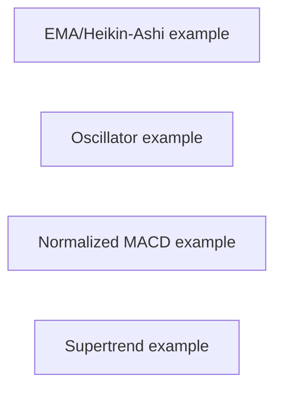
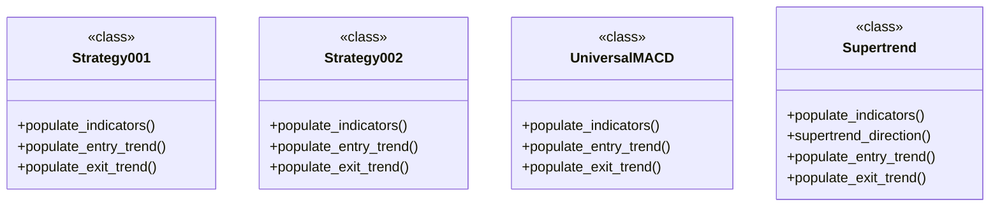
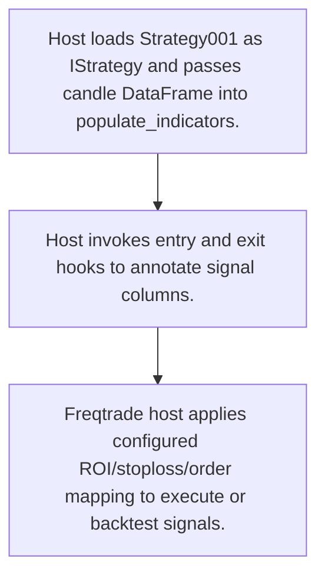
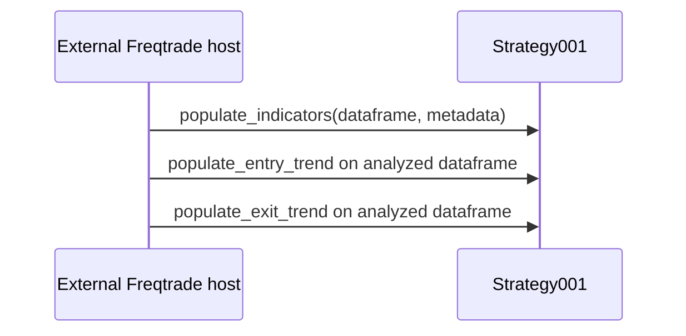

# freqtrade-strategies: workflow, design and architecture

Updated: **2026-10-13**
Reviewed Git hash: `b5b33f2b2d793faa382d8c346db8a7bba9cca3b6`
Branch: `feature/ayu_develop`
Source diff SHA256: `e3b0c44298fc1c149afbf4c8996fb92427ae41e4649b934ca495991b7852b855`
Scope: **Educational strategy plugin collection** / Maintenance: **companion**
Languages: Python

[HTML edition](ayu-develop.html) / [Development](development.md) / [Historical validation](validation.md) / [Full system comparison](../../docs/index.html)

## Purpose and scope

Provide example Freqtrade IStrategy subclasses and tunable indicator/signal definitions; execution, historical data and optimization runners belong to Freqtrade.

## Features and support boundaries

Native = implemented here. Integration = supplied through a named host/API. Limited = material restriction. Not provided = evidenced scope exclusion. Unverified = support/absence not established. Not applicable = outside this artifact type.

| Capability | Status | Implementation and limits | Source |
|---|---|---|---|
| Backtesting | Integration | External Freqtrade host supplies runtime behavior; strategy classes only declare signals and host-consumed ROI/stoploss/order settings. | [README.md](../README.md) ([L3](https://github.com/alexcwyu/freqtrade-strategies/blob/b5b33f2b2d793faa382d8c346db8a7bba9cca3b6/README.md#L3)) / [Strategy001](../src/freqtrade_strategies/Strategy001.py) ([L13](https://github.com/alexcwyu/freqtrade-strategies/blob/b5b33f2b2d793faa382d8c346db8a7bba9cca3b6/src/freqtrade_strategies/Strategy001.py#L13)) |
| Live execution | Integration | External Freqtrade host supplies runtime behavior; strategy classes only declare signals and host-consumed ROI/stoploss/order settings. | [README.md](../README.md) ([L3](https://github.com/alexcwyu/freqtrade-strategies/blob/b5b33f2b2d793faa382d8c346db8a7bba9cca3b6/README.md#L3)) / [Strategy001](../src/freqtrade_strategies/Strategy001.py) ([L13](https://github.com/alexcwyu/freqtrade-strategies/blob/b5b33f2b2d793faa382d8c346db8a7bba9cca3b6/src/freqtrade_strategies/Strategy001.py#L13)) |
| Paper trading | Integration | External Freqtrade host supplies runtime behavior; strategy classes only declare signals and host-consumed ROI/stoploss/order settings. | [README.md](../README.md) ([L3](https://github.com/alexcwyu/freqtrade-strategies/blob/b5b33f2b2d793faa382d8c346db8a7bba9cca3b6/README.md#L3)) / [Strategy001](../src/freqtrade_strategies/Strategy001.py) ([L13](https://github.com/alexcwyu/freqtrade-strategies/blob/b5b33f2b2d793faa382d8c346db8a7bba9cca3b6/src/freqtrade_strategies/Strategy001.py#L13)) |
| Event driven | Integration | External Freqtrade host supplies runtime behavior; strategy classes only declare signals and host-consumed ROI/stoploss/order settings. | [README.md](../README.md) ([L3](https://github.com/alexcwyu/freqtrade-strategies/blob/b5b33f2b2d793faa382d8c346db8a7bba9cca3b6/README.md#L3)) / [Strategy001](../src/freqtrade_strategies/Strategy001.py) ([L13](https://github.com/alexcwyu/freqtrade-strategies/blob/b5b33f2b2d793faa382d8c346db8a7bba9cca3b6/src/freqtrade_strategies/Strategy001.py#L13)) |
| Vectorized | Limited | Most examples use DataFrame signal masks and TA-Lib arrays; Supertrend also has iterative indicator logic, and no portfolio simulation kernel exists here. | [Strategy001.populate_entry_trend](../src/freqtrade_strategies/Strategy001.py) ([L93](https://github.com/alexcwyu/freqtrade-strategies/blob/b5b33f2b2d793faa382d8c346db8a7bba9cca3b6/src/freqtrade_strategies/Strategy001.py#L93)) / [Supertrend.supertrend_direction](../src/freqtrade_strategies/Supertrend.py) ([L148](https://github.com/alexcwyu/freqtrade-strategies/blob/b5b33f2b2d793faa382d8c346db8a7bba9cca3b6/src/freqtrade_strategies/Supertrend.py#L148)) |
| Order management | Integration | External Freqtrade host supplies runtime behavior; strategy classes only declare signals and host-consumed ROI/stoploss/order settings. | [README.md](../README.md) ([L3](https://github.com/alexcwyu/freqtrade-strategies/blob/b5b33f2b2d793faa382d8c346db8a7bba9cca3b6/README.md#L3)) / [Strategy001](../src/freqtrade_strategies/Strategy001.py) ([L13](https://github.com/alexcwyu/freqtrade-strategies/blob/b5b33f2b2d793faa382d8c346db8a7bba9cca3b6/src/freqtrade_strategies/Strategy001.py#L13)) |
| Order types | Integration | External Freqtrade host supplies runtime behavior; strategy classes only declare signals and host-consumed ROI/stoploss/order settings. | [README.md](../README.md) ([L3](https://github.com/alexcwyu/freqtrade-strategies/blob/b5b33f2b2d793faa382d8c346db8a7bba9cca3b6/README.md#L3)) / [Strategy001](../src/freqtrade_strategies/Strategy001.py) ([L13](https://github.com/alexcwyu/freqtrade-strategies/blob/b5b33f2b2d793faa382d8c346db8a7bba9cca3b6/src/freqtrade_strategies/Strategy001.py#L13)) |
| Multi venue | Unverified | Representative source review did not establish this capability; no claim of absence. | Not applicable to this repository scope. |
| Crypto | Integration | External Freqtrade host supplies runtime behavior; strategy classes only declare signals and host-consumed ROI/stoploss/order settings. | [README.md](../README.md) ([L3](https://github.com/alexcwyu/freqtrade-strategies/blob/b5b33f2b2d793faa382d8c346db8a7bba9cca3b6/README.md#L3)) / [Strategy001](../src/freqtrade_strategies/Strategy001.py) ([L13](https://github.com/alexcwyu/freqtrade-strategies/blob/b5b33f2b2d793faa382d8c346db8a7bba9cca3b6/src/freqtrade_strategies/Strategy001.py#L13)) |
| Equities | Unverified | Representative source review did not establish this capability; no claim of absence. | Not applicable to this repository scope. |
| Futures | Unverified | Representative source review did not establish this capability; no claim of absence. | Not applicable to this repository scope. |
| Options | Unverified | Representative source review did not establish this capability; no claim of absence. | Not applicable to this repository scope. |
| Forex | Unverified | Representative source review did not establish this capability; no claim of absence. | Not applicable to this repository scope. |
| Strategy api | Integration | Implements concrete Freqtrade IStrategy callbacks; strategy interface definition/runtime is external. | [Strategy001](../src/freqtrade_strategies/Strategy001.py) ([L13](https://github.com/alexcwyu/freqtrade-strategies/blob/b5b33f2b2d793faa382d8c346db8a7bba9cca3b6/src/freqtrade_strategies/Strategy001.py#L13)) / [Strategy001.populate_entry_trend](../src/freqtrade_strategies/Strategy001.py) ([L93](https://github.com/alexcwyu/freqtrade-strategies/blob/b5b33f2b2d793faa382d8c346db8a7bba9cca3b6/src/freqtrade_strategies/Strategy001.py#L93)) |
| Optimization | Integration | UniversalMACD DecimalParameter and Supertrend IntParameter ranges are consumed by Freqtrade hyperopt runner. | [UniversalMACD](../src/freqtrade_strategies/UniversalMACD.py) ([L21](https://github.com/alexcwyu/freqtrade-strategies/blob/b5b33f2b2d793faa382d8c346db8a7bba9cca3b6/src/freqtrade_strategies/UniversalMACD.py#L21)) / [Supertrend.populate_indicators](../src/freqtrade_strategies/Supertrend.py) ([L84](https://github.com/alexcwyu/freqtrade-strategies/blob/b5b33f2b2d793faa382d8c346db8a7bba9cca3b6/src/freqtrade_strategies/Supertrend.py#L84)) |
| Machine learning | Unverified | Representative source review did not establish this capability; no claim of absence. | Not applicable to this repository scope. |
| Reinforcement learning | Unverified | Representative source review did not establish this capability; no claim of absence. | Not applicable to this repository scope. |
| Portfolio | Integration | External Freqtrade host supplies runtime behavior; strategy classes only declare signals and host-consumed ROI/stoploss/order settings. | [README.md](../README.md) ([L3](https://github.com/alexcwyu/freqtrade-strategies/blob/b5b33f2b2d793faa382d8c346db8a7bba9cca3b6/README.md#L3)) / [Strategy001](../src/freqtrade_strategies/Strategy001.py) ([L13](https://github.com/alexcwyu/freqtrade-strategies/blob/b5b33f2b2d793faa382d8c346db8a7bba9cca3b6/src/freqtrade_strategies/Strategy001.py#L13)) |
| Risk management | Integration | External Freqtrade host supplies runtime behavior; strategy classes only declare signals and host-consumed ROI/stoploss/order settings. | [README.md](../README.md) ([L3](https://github.com/alexcwyu/freqtrade-strategies/blob/b5b33f2b2d793faa382d8c346db8a7bba9cca3b6/README.md#L3)) / [Strategy001](../src/freqtrade_strategies/Strategy001.py) ([L13](https://github.com/alexcwyu/freqtrade-strategies/blob/b5b33f2b2d793faa382d8c346db8a7bba9cca3b6/src/freqtrade_strategies/Strategy001.py#L13)) |
| Performance analytics | Integration | External Freqtrade host supplies runtime behavior; strategy classes only declare signals and host-consumed ROI/stoploss/order settings. | [README.md](../README.md) ([L3](https://github.com/alexcwyu/freqtrade-strategies/blob/b5b33f2b2d793faa382d8c346db8a7bba9cca3b6/README.md#L3)) / [Strategy001](../src/freqtrade_strategies/Strategy001.py) ([L13](https://github.com/alexcwyu/freqtrade-strategies/blob/b5b33f2b2d793faa382d8c346db8a7bba9cca3b6/src/freqtrade_strategies/Strategy001.py#L13)) |
| Historical data | Integration | External Freqtrade host supplies runtime behavior; strategy classes only declare signals and host-consumed ROI/stoploss/order settings. | [README.md](../README.md) ([L3](https://github.com/alexcwyu/freqtrade-strategies/blob/b5b33f2b2d793faa382d8c346db8a7bba9cca3b6/README.md#L3)) / [Strategy001](../src/freqtrade_strategies/Strategy001.py) ([L13](https://github.com/alexcwyu/freqtrade-strategies/blob/b5b33f2b2d793faa382d8c346db8a7bba9cca3b6/src/freqtrade_strategies/Strategy001.py#L13)) |
| Streaming data | Unverified | Representative source review did not establish this capability; no claim of absence. | Not applicable to this repository scope. |
| Persistence | Integration | External Freqtrade host supplies runtime behavior; strategy classes only declare signals and host-consumed ROI/stoploss/order settings. | [README.md](../README.md) ([L3](https://github.com/alexcwyu/freqtrade-strategies/blob/b5b33f2b2d793faa382d8c346db8a7bba9cca3b6/README.md#L3)) / [Strategy001](../src/freqtrade_strategies/Strategy001.py) ([L13](https://github.com/alexcwyu/freqtrade-strategies/blob/b5b33f2b2d793faa382d8c346db8a7bba9cca3b6/src/freqtrade_strategies/Strategy001.py#L13)) |
| Data pipeline | Unverified | Representative source review did not establish this capability; no claim of absence. | Not applicable to this repository scope. |
| Web ui | Unverified | Representative source review did not establish this capability; no claim of absence. | Not applicable to this repository scope. |
| Cli | Integration | External Freqtrade host supplies runtime behavior; strategy classes only declare signals and host-consumed ROI/stoploss/order settings. | [README.md](../README.md) ([L3](https://github.com/alexcwyu/freqtrade-strategies/blob/b5b33f2b2d793faa382d8c346db8a7bba9cca3b6/README.md#L3)) / [Strategy001](../src/freqtrade_strategies/Strategy001.py) ([L13](https://github.com/alexcwyu/freqtrade-strategies/blob/b5b33f2b2d793faa382d8c346db8a7bba9cca3b6/src/freqtrade_strategies/Strategy001.py#L13)) |
| Monitoring | Unverified | Representative source review did not establish this capability; no claim of absence. | Not applicable to this repository scope. |
| Extension api | Integration | Concrete classes are host extensions, not an independent local extension manager. | [Strategy001](../src/freqtrade_strategies/Strategy001.py) ([L13](https://github.com/alexcwyu/freqtrade-strategies/blob/b5b33f2b2d793faa382d8c346db8a7bba9cca3b6/src/freqtrade_strategies/Strategy001.py#L13)) |
| Native acceleration | Integration | Indicator computation imports external TA-Lib; local strategy code is Python. | [Strategy001.populate_indicators](../src/freqtrade_strategies/Strategy001.py) ([L74](https://github.com/alexcwyu/freqtrade-strategies/blob/b5b33f2b2d793faa382d8c346db8a7bba9cca3b6/src/freqtrade_strategies/Strategy001.py#L74)) |
| Distributed execution | Unverified | Representative source review did not establish this capability; no claim of absence. | Not applicable to this repository scope. |

## System components

| Component | Responsibility | Source |
|---|---|---|
| EMA/Heikin-Ashi example | Indicator preparation and entry/exit masks. | [Strategy001.populate_indicators](../src/freqtrade_strategies/Strategy001.py) ([L74](https://github.com/alexcwyu/freqtrade-strategies/blob/b5b33f2b2d793faa382d8c346db8a7bba9cca3b6/src/freqtrade_strategies/Strategy001.py#L74)) / [Strategy001.populate_entry_trend](../src/freqtrade_strategies/Strategy001.py) ([L93](https://github.com/alexcwyu/freqtrade-strategies/blob/b5b33f2b2d793faa382d8c346db8a7bba9cca3b6/src/freqtrade_strategies/Strategy001.py#L93)) / [Strategy001.populate_exit_trend](../src/freqtrade_strategies/Strategy001.py) ([L109](https://github.com/alexcwyu/freqtrade-strategies/blob/b5b33f2b2d793faa382d8c346db8a7bba9cca3b6/src/freqtrade_strategies/Strategy001.py#L109)) |
| Oscillator example | Alternative stochastic/RSI/Bollinger/SAR feature set. | [Strategy002.populate_indicators](../src/freqtrade_strategies/Strategy002.py) ([L75](https://github.com/alexcwyu/freqtrade-strategies/blob/b5b33f2b2d793faa382d8c346db8a7bba9cca3b6/src/freqtrade_strategies/Strategy002.py#L75)) |
| Normalized MACD example | Host parameter-bound entry/exit strategy. | [UniversalMACD.populate_indicators](../src/freqtrade_strategies/UniversalMACD.py) ([L85](https://github.com/alexcwyu/freqtrade-strategies/blob/b5b33f2b2d793faa382d8c346db8a7bba9cca3b6/src/freqtrade_strategies/UniversalMACD.py#L85)) / [UniversalMACD.populate_entry_trend](../src/freqtrade_strategies/UniversalMACD.py) ([L96](https://github.com/alexcwyu/freqtrade-strategies/blob/b5b33f2b2d793faa382d8c346db8a7bba9cca3b6/src/freqtrade_strategies/UniversalMACD.py#L96)) |
| Supertrend example | Compute ranged indicator direction columns for host optimization. | [Supertrend.populate_indicators](../src/freqtrade_strategies/Supertrend.py) ([L84](https://github.com/alexcwyu/freqtrade-strategies/blob/b5b33f2b2d793faa382d8c346db8a7bba9cca3b6/src/freqtrade_strategies/Supertrend.py#L84)) / [Supertrend.supertrend_direction](../src/freqtrade_strategies/Supertrend.py) ([L148](https://github.com/alexcwyu/freqtrade-strategies/blob/b5b33f2b2d793faa382d8c346db8a7bba9cca3b6/src/freqtrade_strategies/Supertrend.py#L148)) |

## Architecture and component boundaries

The component view summarizes inspected responsibility boundaries. Arrows identify the documented API/data dependencies; this is not a deployment-readiness claim.

## Design decisions

| Decision | Rationale | Tradeoff | Evidence |
|---|---|---|---|
| Express strategies as IStrategy callback subclasses. | Keeps examples small and delegates exchange/order/portfolio mechanics to host. | Usability depends on host interface and external indicator dependency compatibility. | [Strategy001](../src/freqtrade_strategies/Strategy001.py) ([L13](https://github.com/alexcwyu/freqtrade-strategies/blob/b5b33f2b2d793faa382d8c346db8a7bba9cca3b6/src/freqtrade_strategies/Strategy001.py#L13)) / [UniversalMACD](../src/freqtrade_strategies/UniversalMACD.py) ([L21](https://github.com/alexcwyu/freqtrade-strategies/blob/b5b33f2b2d793faa382d8c346db8a7bba9cca3b6/src/freqtrade_strategies/UniversalMACD.py#L21)) |

## Class and interface relationships

Each node is a reviewed source symbol. Function/module nodes are explicitly labeled; they do not imply Python classes. Only reviewed relationships are drawn.

- **Strategy001** (class): [Strategy001.populate_indicators](../src/freqtrade_strategies/Strategy001.py) ([L74](https://github.com/alexcwyu/freqtrade-strategies/blob/b5b33f2b2d793faa382d8c346db8a7bba9cca3b6/src/freqtrade_strategies/Strategy001.py#L74))
- **Strategy002** (class): [Strategy002.populate_indicators](../src/freqtrade_strategies/Strategy002.py) ([L75](https://github.com/alexcwyu/freqtrade-strategies/blob/b5b33f2b2d793faa382d8c346db8a7bba9cca3b6/src/freqtrade_strategies/Strategy002.py#L75))
- **UniversalMACD** (class): [UniversalMACD.populate_indicators](../src/freqtrade_strategies/UniversalMACD.py) ([L85](https://github.com/alexcwyu/freqtrade-strategies/blob/b5b33f2b2d793faa382d8c346db8a7bba9cca3b6/src/freqtrade_strategies/UniversalMACD.py#L85))
- **Supertrend** (class): [Supertrend.populate_indicators](../src/freqtrade_strategies/Supertrend.py) ([L84](https://github.com/alexcwyu/freqtrade-strategies/blob/b5b33f2b2d793faa382d8c346db8a7bba9cca3b6/src/freqtrade_strategies/Supertrend.py#L84))

## Workflow

### Load an example into Freqtrade

All runtime steps occur through the external Freqtrade host. Other reviewed strategies are alternatives, not subsequent workflow stages.

1. Host loads Strategy001 as IStrategy and passes candle DataFrame into populate_indicators.. [Strategy001](../src/freqtrade_strategies/Strategy001.py) ([L13](https://github.com/alexcwyu/freqtrade-strategies/blob/b5b33f2b2d793faa382d8c346db8a7bba9cca3b6/src/freqtrade_strategies/Strategy001.py#L13)) / [Strategy001.populate_indicators](../src/freqtrade_strategies/Strategy001.py) ([L74](https://github.com/alexcwyu/freqtrade-strategies/blob/b5b33f2b2d793faa382d8c346db8a7bba9cca3b6/src/freqtrade_strategies/Strategy001.py#L74))
2. Host invokes entry and exit hooks to annotate signal columns.. [Strategy001.populate_entry_trend](../src/freqtrade_strategies/Strategy001.py) ([L93](https://github.com/alexcwyu/freqtrade-strategies/blob/b5b33f2b2d793faa382d8c346db8a7bba9cca3b6/src/freqtrade_strategies/Strategy001.py#L93)) / [Strategy001.populate_exit_trend](../src/freqtrade_strategies/Strategy001.py) ([L109](https://github.com/alexcwyu/freqtrade-strategies/blob/b5b33f2b2d793faa382d8c346db8a7bba9cca3b6/src/freqtrade_strategies/Strategy001.py#L109))
3. Freqtrade host applies configured ROI/stoploss/order mapping to execute or backtest signals.. [Strategy001](../src/freqtrade_strategies/Strategy001.py) ([L13](https://github.com/alexcwyu/freqtrade-strategies/blob/b5b33f2b2d793faa382d8c346db8a7bba9cca3b6/src/freqtrade_strategies/Strategy001.py#L13)) / [README.md](../README.md) ([L3](https://github.com/alexcwyu/freqtrade-strategies/blob/b5b33f2b2d793faa382d8c346db8a7bba9cca3b6/README.md#L3))

## Sequence

Example strategy callback order

Host callback order is conceptual integration contract; this repository implements callback bodies, not the host dispatcher.

- populate_indicators(dataframe, metadata): [Strategy001.populate_indicators](../src/freqtrade_strategies/Strategy001.py) ([L74](https://github.com/alexcwyu/freqtrade-strategies/blob/b5b33f2b2d793faa382d8c346db8a7bba9cca3b6/src/freqtrade_strategies/Strategy001.py#L74))
- populate_entry_trend on analyzed dataframe: [Strategy001.populate_entry_trend](../src/freqtrade_strategies/Strategy001.py) ([L93](https://github.com/alexcwyu/freqtrade-strategies/blob/b5b33f2b2d793faa382d8c346db8a7bba9cca3b6/src/freqtrade_strategies/Strategy001.py#L93))
- populate_exit_trend on analyzed dataframe: [Strategy001.populate_exit_trend](../src/freqtrade_strategies/Strategy001.py) ([L109](https://github.com/alexcwyu/freqtrade-strategies/blob/b5b33f2b2d793faa382d8c346db8a7bba9cca3b6/src/freqtrade_strategies/Strategy001.py#L109))

## Strengths and limits

### Strengths

- Example callback bodies expose exactly which indicators and conditions produce entry/exit columns. [Strategy001.populate_indicators](../src/freqtrade_strategies/Strategy001.py) ([L74](https://github.com/alexcwyu/freqtrade-strategies/blob/b5b33f2b2d793faa382d8c346db8a7bba9cca3b6/src/freqtrade_strategies/Strategy001.py#L74)) / [Strategy001.populate_entry_trend](../src/freqtrade_strategies/Strategy001.py) ([L93](https://github.com/alexcwyu/freqtrade-strategies/blob/b5b33f2b2d793faa382d8c346db8a7bba9cca3b6/src/freqtrade_strategies/Strategy001.py#L93)) / [UniversalMACD.populate_entry_trend](../src/freqtrade_strategies/UniversalMACD.py) ([L96](https://github.com/alexcwyu/freqtrade-strategies/blob/b5b33f2b2d793faa382d8c346db8a7bba9cca3b6/src/freqtrade_strategies/UniversalMACD.py#L96))

### Limitations

- Educational examples and stored optimizer result comments do not establish profitability or readiness on current markets. [README.md](../README.md) ([L3](https://github.com/alexcwyu/freqtrade-strategies/blob/b5b33f2b2d793faa382d8c346db8a7bba9cca3b6/README.md#L3)) / [UniversalMACD](../src/freqtrade_strategies/UniversalMACD.py) ([L21](https://github.com/alexcwyu/freqtrade-strategies/blob/b5b33f2b2d793faa382d8c346db8a7bba9cca3b6/src/freqtrade_strategies/UniversalMACD.py#L21))

## Validation scope

The linked validation and command records preserve actual historical runs and user-authorized exclusions. This source/document review does not rerun application tests, establish live trading readiness or rank benchmark performance. Current data, credential and runtime prerequisites remain material.

[Repository validation](validation.md) / [Executed checks](maintenance/index.md)

## Source map

| Reviewed symbol/path | Inspected responsibility | Actual file SHA256 |
|---|---|---|
| [Strategy001.populate_indicators](../src/freqtrade_strategies/Strategy001.py) ([L74](https://github.com/alexcwyu/freqtrade-strategies/blob/b5b33f2b2d793faa382d8c346db8a7bba9cca3b6/src/freqtrade_strategies/Strategy001.py#L74)) | Adds EMA20/50/100 and Heikin-Ashi columns through TA-Lib/qtpylib. | `2357996e6594458e8db45b5f757918462afa3c998de9d06e2af0c009ddc4b80d` |
| [Strategy001.populate_entry_trend](../src/freqtrade_strategies/Strategy001.py) ([L93](https://github.com/alexcwyu/freqtrade-strategies/blob/b5b33f2b2d793faa382d8c346db8a7bba9cca3b6/src/freqtrade_strategies/Strategy001.py#L93)) | Sets enter_long using EMA crossing and Heikin-Ashi trend conditions. | `2357996e6594458e8db45b5f757918462afa3c998de9d06e2af0c009ddc4b80d` |
| [Strategy001.populate_exit_trend](../src/freqtrade_strategies/Strategy001.py) ([L109](https://github.com/alexcwyu/freqtrade-strategies/blob/b5b33f2b2d793faa382d8c346db8a7bba9cca3b6/src/freqtrade_strategies/Strategy001.py#L109)) | Sets exit_long using crossover and bearish Heikin-Ashi conditions. | `2357996e6594458e8db45b5f757918462afa3c998de9d06e2af0c009ddc4b80d` |
| [Strategy001](../src/freqtrade_strategies/Strategy001.py) ([L13](https://github.com/alexcwyu/freqtrade-strategies/blob/b5b33f2b2d793faa382d8c346db8a7bba9cca3b6/src/freqtrade_strategies/Strategy001.py#L13)) | Declares IStrategy version 3, 5m timeframe, ROI/stoploss and limit entry/exit with market stoploss mapping. | `2357996e6594458e8db45b5f757918462afa3c998de9d06e2af0c009ddc4b80d` |
| [Strategy002.populate_indicators](../src/freqtrade_strategies/Strategy002.py) ([L75](https://github.com/alexcwyu/freqtrade-strategies/blob/b5b33f2b2d793faa382d8c346db8a7bba9cca3b6/src/freqtrade_strategies/Strategy002.py#L75)) | Adds stochastic, RSI/Fisher RSI, Bollinger bands and SAR columns. | `d1ca86a4ceb68ef828b35490ce1112330dad209cc3bb1e1b6c303c21ab3d8a90` |
| [UniversalMACD.populate_indicators](../src/freqtrade_strategies/UniversalMACD.py) ([L85](https://github.com/alexcwyu/freqtrade-strategies/blob/b5b33f2b2d793faa382d8c346db8a7bba9cca3b6/src/freqtrade_strategies/UniversalMACD.py#L85)) | Computes normalized EMA12/EMA26 ratio indicator. | `b3a62e0d8a26024e7ab5f3613d0964e3954373bc3735c1ffd0678d84ce1b1e32` |
| [UniversalMACD.populate_entry_trend](../src/freqtrade_strategies/UniversalMACD.py) ([L96](https://github.com/alexcwyu/freqtrade-strategies/blob/b5b33f2b2d793faa382d8c346db8a7bba9cca3b6/src/freqtrade_strategies/UniversalMACD.py#L96)) | Uses host DecimalParameter values as bounds for enter_long condition. | `b3a62e0d8a26024e7ab5f3613d0964e3954373bc3735c1ffd0678d84ce1b1e32` |
| [UniversalMACD](../src/freqtrade_strategies/UniversalMACD.py) ([L21](https://github.com/alexcwyu/freqtrade-strategies/blob/b5b33f2b2d793faa382d8c346db8a7bba9cca3b6/src/freqtrade_strategies/UniversalMACD.py#L21)) | Declares tunable buy/sell DecimalParameter ranges; historical result comments are not current measured performance. | `b3a62e0d8a26024e7ab5f3613d0964e3954373bc3735c1ffd0678d84ce1b1e32` |
| [Supertrend.populate_indicators](../src/freqtrade_strategies/Supertrend.py) ([L84](https://github.com/alexcwyu/freqtrade-strategies/blob/b5b33f2b2d793faa382d8c346db8a7bba9cca3b6/src/freqtrade_strategies/Supertrend.py#L84)) | Iterates host IntParameter ranges, computes supertrend columns and concatenates columns once. | `c73d2dc221e2a52274b20846bed0879212eaca72916948e8c6103f4d4dd8aeea` |
| [Supertrend.supertrend_direction](../src/freqtrade_strategies/Supertrend.py) ([L148](https://github.com/alexcwyu/freqtrade-strategies/blob/b5b33f2b2d793faa382d8c346db8a7bba9cca3b6/src/freqtrade_strategies/Supertrend.py#L148)) | Builds indicator direction series from ATR and iterative trend-band logic. | `c73d2dc221e2a52274b20846bed0879212eaca72916948e8c6103f4d4dd8aeea` |
| [README.md](../README.md) ([L3](https://github.com/alexcwyu/freqtrade-strategies/blob/b5b33f2b2d793faa382d8c346db8a7bba9cca3b6/README.md#L3)) | Explicitly identifies collection as free educational buy/sell strategies for Freqtrade. | `063735d8f8dfdcc4573f75fe64263b4e6452b2204244dc211e29d1c66e404157` |

## Documentation provenance

Review date: 2026-10-13. Full committed source HEAD: `b5b33f2b2d793faa382d8c346db8a7bba9cca3b6`. Template version: 2. 5 source files were independently hashed for this guide.

[Evidence catalog](../../docs/systems-2026-10-13/catalog.json) / [Standard template](../../docs/guidelines/APP_TEMPLATE.md)

- Read-only source audit of inventory HEAD b5b33f2b2d793faa382d8c346db8a7bba9cca3b6; no runtime execution, credential check or live-production assertion. Existing validation records remain separate historical evidence.
- Reviewed subclasses share external IStrategy base; no inheritance/call links among the four independent example strategy classes. Relationships and architecture edges intentionally empty rather than inventing a shared local engine.
- Inspected implementation/configuration coverage: src/freqtrade_strategies/Strategy001.py, src/freqtrade_strategies/Strategy002.py, src/freqtrade_strategies/UniversalMACD.py, src/freqtrade_strategies/Supertrend.py, README.md
- Source symbols and call chains are representative coverage, not exhaustive connector, strategy or product certification. Integration statuses identify dependencies that supply the runtime behavior.
