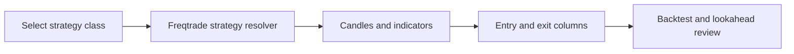
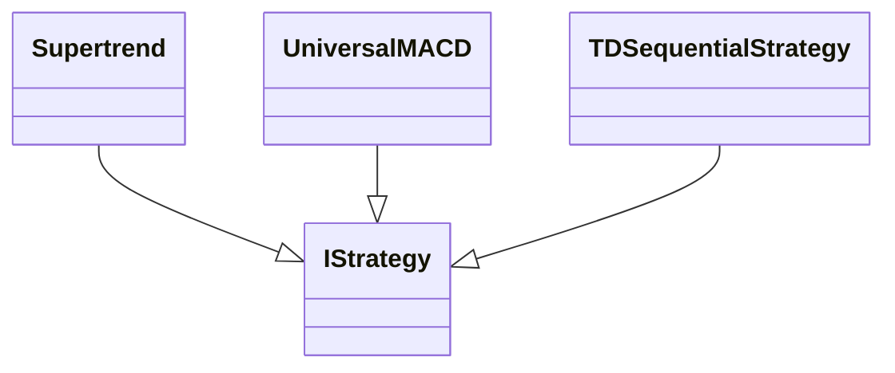
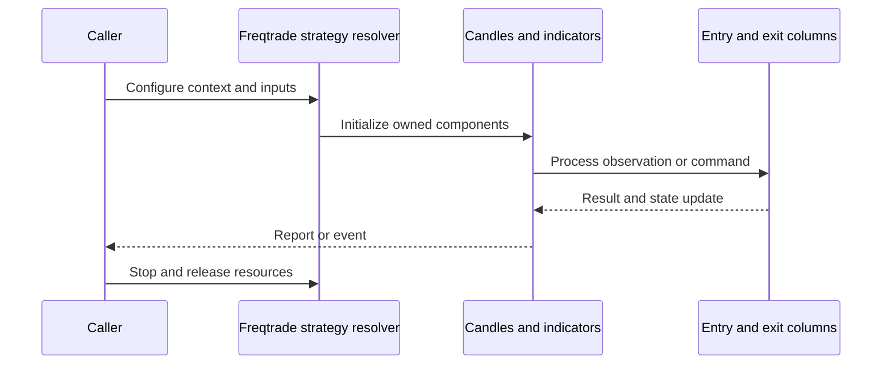
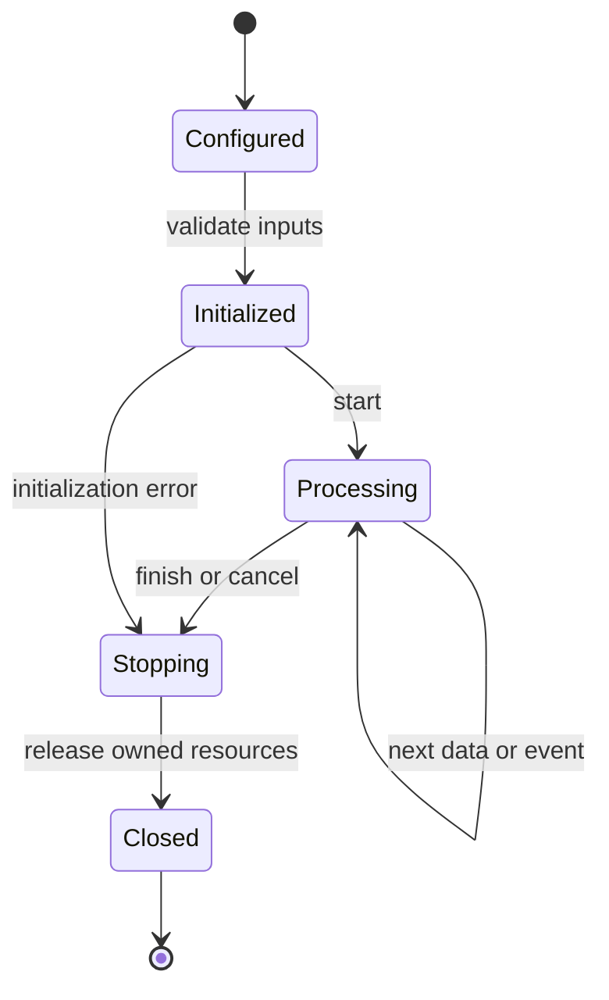
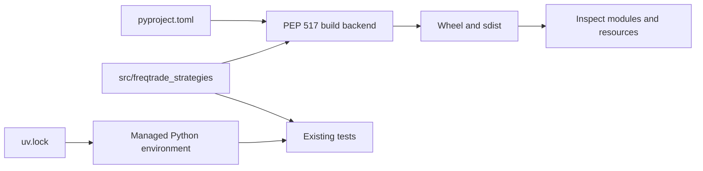
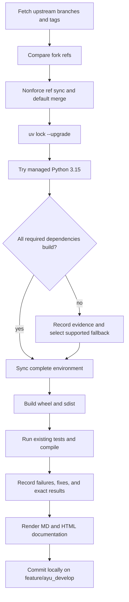

# freqtrade-strategies: architecture and development

This repository is a strategy collection consumed by Freqtrade. It packages example indicator-based strategies and execution examples; the exchange runtime, risk handling, and persistence belong to Freqtrade.

## Components and boundaries

Strategy modules inherit IStrategy and implement populate_indicators, populate_entry_trend, and populate_exit_trend or custom execution hooks. Modules organize examples by author and topic. Strategies expose ROI/stop-loss/time-frame settings to the host. The lookahead_bias directory explicitly groups examples with biased behavior so evaluation workflows can inspect them separately.

The following class view names implementation classes. Cross-package types are supplied by the host ecosystem; arrows describe inheritance or usage, not copied ownership.

## Runtime workflow

Select a class and compatible Freqtrade host, point strategy-path at the source collection, load candles, calculate indicators, mark entry/exit columns, and execute backtesting or lookahead analysis. The host applies fees, exchange precision, order handling, and account accounting. Review validation and risk behavior before any live deployment.

This sequence is an architectural view of responsibility and resource ownership. Individual plugin, connector, and strategy implementations can add asynchronous events and error branches. The lifecycle below is a conceptual operating workflow, rather than a claim that every component has one shared state enum.

## Features and extension points

MACD, RSI, bands and supertrend examples; TD Sequential; Almgren-Chriss and TWAP execution examples; author collections; explicitly identified lookahead-bias samples.

Extend the owning component behind its existing public interface. Keep metadata and configuration alongside plugin/strategy resources. Exchange-specific behavior belongs in an adapter; strategy decisions belong in the strategy/evaluator layer; persistence schema and migrations belong with the storage implementation. Review the source map below before changing a boundary, and exercise the existing tests associated with that boundary.

## Packaging and dependency design

The collection can compile and build on Python 3.15. Its import/runtime dependencies are supplied by the separately installed Freqtrade host; Python packaging success is not a performance or live-trading claim. No additional test cases were introduced. Any existing repository suite that collects zero tests is recorded with pytest exit 5.

The lock records exact package versions, hashes, platform markers, and local source mappings. Path sources deliberately bind related repositories in this workspace; clone sibling repositories at the documented names before synchronization. Published packaging metadata describes public dependencies, while uv source settings select this development workspace. Resolve dependency changes with uv lock --upgrade and retain the generated lock, then verify the same locked environment.

## Maintenance workflow

All upstream branches and tags are fetched. Fork updates use nonforce pushes; a divergent branch is merged without erasing fork history. The default branch is merged into feature/ayu_develop with package/resource conflicts reconciled in their installed locations. Build and test evidence is recorded before a local maintenance commit. Feature branch publication is a separate root-level action.

No existing test assertions are removed and no new test cases are introduced in this maintenance pass. Corrected fixtures preserve coverage while making paths, corruption inputs, and resource cleanup compatible with the selected interpreter. A failed test or unsupported dependency is reported explicitly in [validation](validation.md); package build success does not imply strategy correctness, profitability, or successful live connectivity.

## Source map

| Source | Responsibility and location |
| --- | --- |
| [Supertrend.py](../src/freqtrade_strategies/Supertrend.py) | src/freqtrade_strategies/Supertrend.py |
| [UniversalMACD.py](../src/freqtrade_strategies/UniversalMACD.py) | src/freqtrade_strategies/UniversalMACD.py |
| [PatternRecognition.py](../src/freqtrade_strategies/PatternRecognition.py) | src/freqtrade_strategies/PatternRecognition.py |
| [Strategy001.py](../src/freqtrade_strategies/Strategy001.py) | src/freqtrade_strategies/Strategy001.py |
| [Strategy002.py](../src/freqtrade_strategies/Strategy002.py) | src/freqtrade_strategies/Strategy002.py |
| [GodStra.py](../src/freqtrade_strategies/GodStra.py) | src/freqtrade_strategies/GodStra.py |
| [TDSequentialStrategy.py](../src/freqtrade_strategies/berlinguyinca/TDSequentialStrategy.py) | src/freqtrade_strategies/berlinguyinca/TDSequentialStrategy.py |
| [Zeus.py](../src/freqtrade_strategies/lookahead_bias/Zeus.py) | src/freqtrade_strategies/lookahead_bias/Zeus.py |
| [GodStraNew.py](../src/freqtrade_strategies/lookahead_bias/GodStraNew.py) | src/freqtrade_strategies/lookahead_bias/GodStraNew.py |
| [DevilStra.py](../src/freqtrade_strategies/lookahead_bias/DevilStra.py) | src/freqtrade_strategies/lookahead_bias/DevilStra.py |
| [pyproject.toml](../pyproject.toml) | pyproject.toml |
| [uv.lock](../uv.lock) | uv.lock |
| [README.md](../README.md) | README.md |

## Further reading

Use [development.md](development.md) for reproducible commands and [validation.md](validation.md) for exact interpreter, dependency, build, test, and blocker evidence. The equivalent [HTML architecture document](ayu-develop.html) supports browsing and rendered diagrams.
